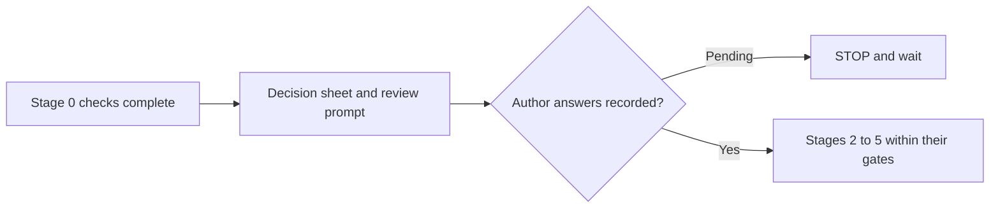

# Paper B author decision sheet — 8 October 2026

Status: **PENDING AUTHOR ANSWERS**. Prepared by Codex (AI-assisted).
Recommendations are proposals, not author decisions or run authorizations.
Stage 0 commit: `3f93c31`; fresh clone tests 207/6/12, smoke 11/11, real PDF
12 pages. Stage 1 stops here; Stages 2–5 have not started.

## 📋 Reply needed now

| ID | Recommended answer | Author answer |
|---|---|---|
| D-PLAN | Adopt v3.1 using Agent_paper_B, subject to D-ROUTE | pending |
| D-DAC1 | Adopt DAC framing, both deviations, no method claim | pending |
| D-F10 | Permit model-free CPU tooling before B1 only | pending |
| D-INFRA-RB | Re-point the two missing-document citations | pending |
| D-ROUTE | Explicitly amend route to after screen / before pilot | pending |

The first four are the execution runbook's "now" items. D-ROUTE is an
additional reconciliation STOP found while reading the scientific authority.
Please answer all five; the later decisions below can wait for their stages.
Your answers will be recorded in OPEN_ITEMS and as a dated RUNBOOK amendment.
No recommendation in this file has been adopted.

## 🔍 Context, options and recommendations

### D-PLAN — Adopt infrastructure plan v3.1

Needed: now. Author answer: pending.

Plan v3.1 is still a draft, based on the source snapshot, and its repository-creation description is stale. Stage 0 verified the existing Agent_paper_B remote. Adopting infrastructure work does not resolve B1/B2 or authorize GPU/model work.

Options: Adopt v3.1 with Agent_paper_B as the repository and the execution runbook as the stage order; or keep it draft and specify revisions.

Recommendation: Adopt with the corrected repository identity. Resolve the route-order discrepancy under D-ROUTE below; preserve frozen science otherwise.

Source: B_INFRA_CONSTRUCTION_PLAN_20261006.md §7; B_EXECUTION_RUNBOOK_20261008.md §3.

### D-DAC1 — Adopt DAC framing

Needed: now. Author answer: pending.

RUNBOOK §15 labels DAC framing proposed; §14.2 remains authoritative. The amendment §1 declares budget-coupled instances and a minimal two-checkpoint binary action space as deviations from standard DAC.

Options: Adopt budget-constrained DAC vocabulary with both deviations and no method or optimality claim; or retain verification-timing vocabulary.

Recommendation: Adopt the framing only. Outcome U, controllers, allocator, comparators and estimands stay fixed.

Source: B_DAC_CONFIGURATOR_AMENDMENT_20261004.md §1, §6; RUNBOOK.md §14.2, §15.

### D-F10 — Allow early model-free live tooling

Needed: now. Author answer: pending.

OPEN_ITEMS B2 currently stops F10 until B1 passes. Plan IP5 proposes an exception to build the dry runner, binder logic and endpoint draft before the one remaining realism attempt passes.

Options: Allow model-free CPU work only before B1; or retain the existing B1-first gate.

Recommendation: Allow only the model-free parts, with live refusal and no endpoint dispatch. Ada engineering still needs D-ADA1 and D-CAP1, and evidence runs still need author-created committed authorization.

Source: B_INFRA_CONSTRUCTION_PLAN_20261006.md IP5; OPEN_ITEMS.md §B2.

### D-INFRA-RB — Resolve missing infrastructure-runbook citations

Needed: now. Author answer: pending.

executor.py and task_cc_live/cc_live_agent.py cite B_INFRA_RUNBOOK_20261005.md, which the standalone records report absent. The source and other checkouts are off limits to this takeover, so I have not searched them.

Options: Author supplies the missing document into B for a reviewed commit; or approve re-pointing both citations to B_EXECUTION_RUNBOOK_20261008.md Stage 4 / IP2.

Recommendation: Re-point the citations to the committed execution runbook; change only the references after approval.

Source: OPEN_ITEMS.md standalone missing-runbook item; B_EXECUTION_RUNBOOK_20261008.md §3.

### D-ROUTE — Resolve screen-versus-pilot route order

Needed: now, with D-PLAN. Author answer: pending.

RUNBOOK §12.2 says the route is decided after the pilot, and §12.3 gives screen → pilot → route. Plan v3.1 IP10 and execution Stage 8 step 4 instead give screen → route → pilot. Gate order is frozen science under execution §2.2; committing the supplied execution order has not amended this scientific gate.

Options: Author explicitly amends RUNBOOK to route after the screen and before the pilot; or retains route after the pilot and requests aligned execution/plan text.

Recommendation: Adopt the explicit after-screen amendment to match the requested execution order; in either case decide before confirmatory outcomes. No later stage proceeds on an inferred resolution.

Source: RUNBOOK.md §12.2, §12.3; B_INFRA_CONSTRUCTION_PLAN_20261006.md IP10.4; B_EXECUTION_RUNBOOK_20261008.md Stage 8.4.

### D-DEC1 — Freeze decoding and repetition seeds

Needed: Stage 4, before endpoint binding. Author answer: pending.

The design requires at least two stochastic repetitions; existing E0 temperature-0 settings cannot simply be reused. The real adapter seed transport is still an engineering task.

Options: Use a positive temperature with deterministic recorded per-repetition seeds passed to llama-server; or supply another justified stochastic scheme as an amendment.

Recommendation: Positive temperature with a frozen seed derivation and transport test. Choose the value from engineering smoke behavior, without outcome-based tuning; specify how this selection is permitted before the smoke.

Source: B_INFRA_CONSTRUCTION_PLAN_20261006.md IP2.6, IP5.1; execution §2 lesson L3.

### D-CAP1 — Declare allowances and qualification accounting

Needed: Stage 5, before any Ada engineering. Author answer: pending.

The existing 512 leaves are fully assigned: 96 screen + 384 pilot + 32 integrity controls. Plan IP5.4 asks about engineering and qualification accounting. Qualification remains evidence-producing even if its budget is separately accounted.

Options: Declare separate capped engineering and qualification allocations, preserving the 512 screen/pilot/control cap; or propose an explicit alternative budget amendment.

Recommendation: A small separately declared engineering allowance for binding, one root and smoke. State qualification accounting separately and give numeric leaf/token/wall/accelerator/storage limits and retry limits before dispatch. Never treat an allowance as qualification authorization.

Source: B_INFRA_CONSTRUCTION_PLAN_20261006.md IP5.4; execution §2.4, Stage 6, Stage 7.

### D-RES1 — Declare resumption policy

Needed: Stage 5. Author answer: pending.

Execution lesson L1 reports periodic server loss at about 30 minutes in A; this was not independently inspected here. B tooling must supervise infrastructure stops from its first version, within explicit caps.

Options: Adopt automatic infrastructure resumption with a declared total budget and per-root cap; or specify a stricter stop policy.

Recommendation: Budget from expected screen wall time / 30 minutes × 2 margin, rounded and frozen before launch; per-root cap 5. Count and report resumptions, distinguish infrastructure stops from rule/limit stops, and keep all resource caps active across resumptions.

Source: B_EXECUTION_RUNBOOK_20261008.md §2 L1–L2, §3, Stage 5.2.

### D-ADA1 — Approve Ada access and execution plan

Needed: by 20 October; before Stage 4 access check. Author answer: pending.

Mac and GitHub access are verified. Ada was not contacted: B clone location, GitHub pull/push, card contexts, storage and port availability are unknown. Paper A and its ports/checkouts remain off limits.

Options: Provide a Mac SSH alias and B-only clone location with GitHub access; or provide a B session on Ada with those details. Approve or revise Stages 6–8 within the one-card rule.

Recommendation: B-only clone of Agent_paper_B, port 18084 only if free, one card with no foreign compute context. First do a read-only pre-flight after approval; supply host paths privately rather than committing machine-specific paths.

Source: B_EXECUTION_RUNBOOK_20261008.md §3, Stage 4.6; OPEN_ITEMS.md standalone card item.

### D-DAC2 — Choose the primary encoder

Needed: after IP6 step 1 / Stage 4. Author answer: pending.

Kev and CLM are unbound scaffold slots; the proposed Kev-4B measurement on its OOD suite and ten scripted B transcripts has not run. Plan comparisons are source-reported, not current model results.

Options: Kev-4B primary with CLM ablation after measurement; or CLM primary if the recorded measurement justifies it.

Recommendation: Kev-4B primary, CLM ablation, conditional on accuracy/Brier, latency and token measurements; no selection today.

Source: B_INFRA_CONSTRUCTION_PLAN_20261006.md IP6.1, §7.

### D-DAC3 — Freeze questions and max_chars

Needed: before pilot, after IP6 step 2. Author answer: pending.

Both encoder servers need the same serialised input; wire compatibility alone does not establish equivalent question behavior or truncation.

Options: One shared typed-question set and max_chars, checked on both servers; or a revised jointly justified specification.

Recommendation: One set, statement-form nouls and full-sentence score levels; freeze with SHA-256 after both checks and before pilot outcomes.

Source: B_INFRA_CONSTRUCTION_PLAN_20261006.md IP6.2, §7.

### D-DAC4 — Choose primary feature set

Needed: before pilot. Author answer: pending.

This decision ID selects features; the similarly named B-DAC4 work item is history capture and is not the author decision. Histories currently exist only on the scripted path.

Options: telemetry+embedding with each alone as ablations; or choose one alone as primary.

Recommendation: telemetry+embedding; match the information and capacity of every comparator and freeze before pilot outcomes.

Source: B_DAC_CONFIGURATOR_AMENDMENT_20261004.md §6; plan §7.

### D-DAC5 — Choose projection

Needed: before pilot. Author answer: pending.

The scaffold supports projection, but its primary mode is not adopted. Outcome-blind development-family fitting is required.

Options: standardize for typed questions and PCA k=8 for raw embeddings; or another specified outcome-blind projection.

Recommendation: standardize for typed-question features; PCA k=8 for raw embeddings, with all fitting restricted to development families.

Source: B_INFRA_CONSTRUCTION_PLAN_20261006.md §7; amendment §6.

### D-DAC6 — Choose Kev size

Needed: before pilot. Author answer: pending.

The proposal recommends 4B and conditions any 9B use on acceptable measured Mac latency. No size measurement has been made during takeover.

Options: 4B; or 9B only after a bounded latency measurement supports it.

Recommendation: 4B, with no open-ended size search.

Source: B_INFRA_CONSTRUCTION_PLAN_20261006.md §7.

### D-REF1 — Add descriptive reference policies

Needed: Stage 4. Author answer: pending.

The plan proposes a per-root oracle and budget-matched random reference beside the frozen primary comparators. These must not become selection criteria.

Options: Add both as descriptive only; or omit them.

Recommendation: Adopt as descriptive only, label the oracle clearly and retain the primary comparators unchanged.

Source: B_INFRA_CONSTRUCTION_PLAN_20261006.md IP3.2, §7.

### D-GOV1 — Choose governance depth

Needed: Stage 5. Author answer: pending.

A copied schema, deterministic ledger and scripted tree export exist; adjudication and live ledger integration still need work. The harness executor is a separate architecture.

Options: Schema + B ledger + adjudication; or request a separately scoped governance redesign.

Recommendation: Schema + ledger + adjudication, with B retaining its Pi executor.

Source: B_INFRA_CONSTRUCTION_PLAN_20261006.md IP4, IP8, §7.

### D-GOV2 — Choose visual reporting

Needed: Stage 5. Author answer: pending.

There is no governance UI in the copied harness. A static read-only report is optional and not needed for the scientific gate.

Options: No panel; or a static ledger report.

Recommendation: No panel; static report only if requested and it does not delay the critical path.

Source: B_INFRA_CONSTRUCTION_PLAN_20261006.md §0.3, §7.

### D-PT1 — Choose post-training scope

Needed: after screen. Author answer: pending.

The screen/pilot data are too small and are evaluation families; they do not establish that encoder post-training is useful.

Options: Separate extension after the freeze; or defer post-training entirely.

Recommendation: An extension after the freeze, outside primary analysis and the existing collection allowance.

Source: B_INFRA_CONSTRUCTION_PLAN_20261006.md §0.4, IP7, §7.

### D-PT2 — Choose post-training build order

Needed: after screen. Author answer: pending.

L2 trains CLM heads and needs the Ada pooling stack; L1 trains Kev LoRA/head and requires calibration. Scripted pipeline success is engineering evidence only.

Options: L2 then L1; or defer both pending real posttrain data.

Recommendation: L2 then L1 under separately approved resource allowances; do not infer usefulness from scripted training.

Source: B_INFRA_CONSTRUCTION_PLAN_20261006.md IP7.5, §7.

### D-PT3 — Decide a separate posttrain collection

Needed: after screen; collection after freeze. Author answer: pending.

Plan figures of roughly 3000 leaves / 4M tokens are estimates, not measured costs or authorized budget. Posttrain families must be disjoint from development and test.

Options: Size a separate collection from real screen costs and authorize it later; or omit IP11.

Recommendation: Decide only after measured costs; any evidence-producing extension requires its own author-created committed authorization record.

Source: B_INFRA_CONSTRUCTION_PLAN_20261006.md IP7.7, IP11, §7.

### B2-N — Author novelty and overlap verdict

Needed: before 15 November. Author answer: pending.

The novelty memo and PRIOR_DISCLOSURE §7 need the author verdict; CPU checks and AI-assisted re-review cannot supply it.

Options: Author records a bounded contribution/overlap verdict; or withholds it and revises or retargets B.

Recommendation: The author decides after reading the records, including the verify/continue and myopic-VOI overlap named in autoresearch_harness.

Source: OPEN_ITEMS.md §B2; B_NOVELTY_MEMO.md; PRIOR_DISCLOSURE.md §7.

### B2-BAVAR — Author hand-reading of BAVAR

Needed: before 15 November. Author answer: pending.

The records say automated access to preprints.org 202608.2057 was blocked. The author must confirm the related-work text and BAVAR-inspired comparator description.

Options: Author reads and records corrections or confirmation; or withholds closure pending reading.

Recommendation: Author hand-reading, with claim-specific notes; no AI-assisted review will be called human or external.

Source: OPEN_ITEMS.md §B2; execution §3.

### D-ATT2 — Approve the bounded attempt-2 design

Needed: Stage 2, before sealing or outcome code. Author answer: pending.

Attempt 1 failed and remains unchanged. The attempt-2 design and independent challenge do not exist yet; this is an advance checklist, not a request to approve an unseen design.

Options: Approve the complete challenged design later with an execution-bug-only repair allowance; or reject it and revise before any seal/run.

Recommendation: Execution-bug fixes only, each recorded; seal mechanisms, R1–R9, families/partitions, thresholds, CPU budget and P-B1 failure disposition before implementation. One realism run; no outcome-based tuning.

Source: OPEN_ITEMS.md §B1; execution Stage 2.2–2.6.

### Authorizations — Author creates and commits run authorization

Needed: each evidence phase. Author answer: pending.

Qualification per lane, screen, pilot and final collection are evidence-producing. An author decision on budgets or Ada access does not replace the phase authorization record.

Options: Author runs the prepared authorize command in person on Ada and commits the record; or the phase stays blocked.

Recommendation: In-person authorization after hashes and command are reviewable. The agent never runs authorize and never writes, edits or commits an authorization record. Later pulls may receive the author-created record through GitHub.

Source: B_EXECUTION_RUNBOOK_20261008.md §2.4, Stage 7–9.

## 🔒 Boundaries that remain in force

Science and pinned fixtures remain frozen until dated author amendments.
P-B1's attempt-2 failure disposition and P-B2's 15/30 November cutoffs remain
in force. One Ada card, no foreign compute context, zero new spend. The source
repository and Paper A are off limits; code crosses machines only via GitHub.
No real-agent result, independent-review verdict, or submission readiness is
claimed by this sheet.
