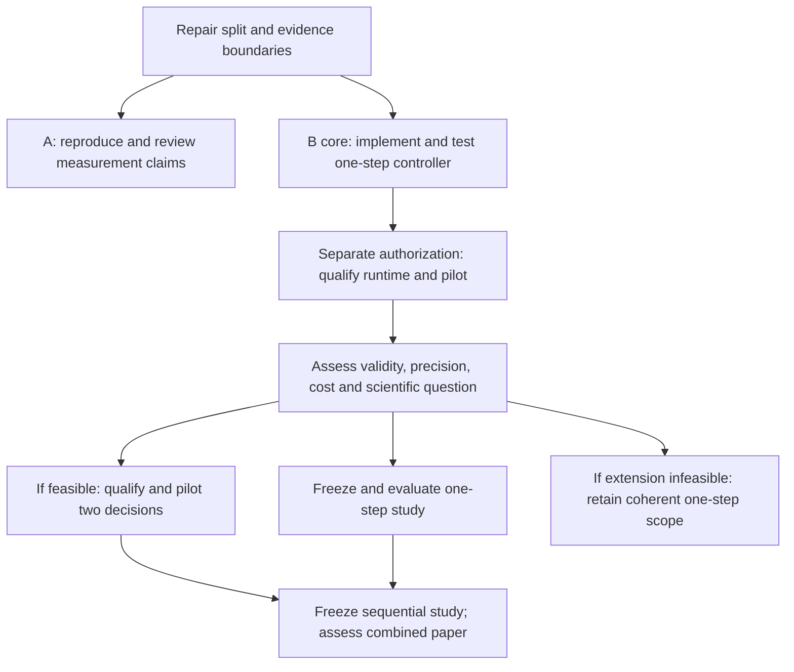

> Copied from the source repository at S = 4154f153, 7 October 2026; this file keeps the general rules (§1–§3, §8, §9, §10) and the Paper B sections (§5–§7 as re-ordered by §11.4, §11.1–§11.4, §12.2, §12.2a, §12.3, §14.2, §15).
> The source copy in agent-checkpoint-intervention is the historical one.

# Paper B runbook: intervention control

This is the Paper B view of the shared A/B runbook v2.4. Section 12 (B
decisions) and §12.2a (controller design v2) govern where they differ from
earlier text. Paper A's sections are not reproduced here; the source
repository holds them.


This is the single canonical plan. It incorporates the user's approved steering:
A remains an independent measurement paper; B combines the original decision
and sequential-control agenda through a one-step core and a gated two-decision
extension. There is no separate Paper C deliverable in this implementation.

## 1. Authority, starting state and deliverables

The September 24 runbook/roadmap and September 26 integration plan are historical
in archive/planning_2026-09-26. Current progress is in [STATUS.md](STATUS.md),
not in archived completion claims. [SCOPE.md](SCOPE.md) fixes ownership;
[CLAIMS.yaml](CLAIMS.yaml) records evidence maturity.

Start from current main. The split already exists: do not migrate the pre-split
manuscript again. Both old branch tips are incorporated into main. The pasted
repair commit 1fdbfc82 remains unavailable; verify each reported repair from the
actual tree. The open repair queue is in [STATUS.md](STATUS.md); the full
continuation report is archived at
[CONTINUATION_2026-09-26.md](https://github.com/dowlingwong/agent-checkpoint-intervention/blob/4154f153/archive/planning_2026-09-26/paper_split_reviews/CONTINUATION_2026-09-26.md).

This implementation round delivers local code, protocols, manuscripts, tests,
engineering-only fixtures, A reproduction and independent release verification.
It also prepares concrete launch specifications. It does not launch real-agent
qualification, pilot or main collection, purchase compute, contact anyone,
submit papers or invent author decisions. External execution requires separately
bound resources and authorization. Do all authorized local work before reporting
those external gates.

| Deliverable | Existing location | Required final behavior |
|---|---|---|
| A manuscript | papers/paper_a/ | Self-contained measurement paper; no B result needed |
| B manuscript | papers/paper_b/ | Controller question; one-step core and conditional two-decision extension |
| Shared measurement | experiment_scaffold/src/causal_branch/measurement/ | One maintained facade and verified dependency closure |
| B control | experiment_scaffold/src/causal_branch/control/ | Correct estimands, baselines, policy selection and sequential state semantics |
| A experiments | experiments/paper_a/ | Reproduce retained evidence without mutating originals |
| B experiments | experiments/paper_b/ | Engineering fixtures separated from future scientific data |
| B contract | protocols/paper_b/contract_v1.yaml currently | Migrate explicitly to b_v2 with phase-aware validation; retain v1 as historical |
| Releases | release/ | Separate committed manifests and clean-package checks |

Do not change frozen historical protocols, evidence or review packages to make a
new check pass. Archived paths have a relocation map; historical freeze-time
checks are run at their original Git revision, not silently rewritten for main.

## 2. Scientific objective and separation

A asks: when do checkpoint branches constrain the intended intervention effect,
what uncertainty can repetition resolve, and what does measurement cost?
Its retained evidence is scoped theory, a closed executable fixture, known-truth
simulation and the negative complete-cost comparison. Keep those limits visible.

B asks: what should an autonomous researcher estimate and do when continuing,
verifying or waiting have different benefits, costs and risks? Its contribution
must be an informative controller result or method beyond known risk/advantage
separation. The controller, not the qualification apparatus, is the deliverable.

Steer B through four commitments:

1. Make a learned controller and its measured decision consequences central.
2. Compare utility, harm, intervention allocation and resources against matched
   outcome-based and strong action-value policies, not just weak risk rankings.
3. Begin with a small, interpretable study: explicit live decision-state capture,
   continue/verify, a frozen verifier-response rule and declared population.
4. Use a disjoint pilot to assess validity, heterogeneity, learnability, precision
   and cost. No positive pilot p-value or desired anticorrelation is a gate.

A targets TMLR subject to scientific/author review. B targets an appropriate
conference conditional on evidence; no assumed deadline or acceptance promise.
TMLR emphasizes supported claims and clear reader interest, rather than a new
state-of-the-art result.[^tmlr] Recheck venue policies at submission preparation.



## 3. Phase P0: verify the current tree and close structural gaps

Record HEAD, branch, dirty paths, interpreter and tools before changes. Preserve
unrelated work, including generated files in the old paper/ directory. Read
MIGRATION.yaml, CLAIMS.yaml, current release manifests and the continuation report.
Use an existing suitable worktree if isolation is needed; do not reset main.

Required repairs and acceptance:

| Work | Minimum observable acceptance |
|---|---|
| Ownership map | Parse required fields; each active object has one owner, source revision, dependencies, disclosure, mutation policy and validation |
| Import direction | AST-based checks catch absolute and relative imports, facade bypass and transitive measurement-to-control dependencies |
| LaTeX separation | Each manuscript's inputs, labels, citations and build dependencies resolve without the other tree |
| Entrypoints | Root targets point to actual paper directories; B has local anonymity, theory and capacity tooling |
| Split contract guard | Real launch checks are exercised: draft refused, resolved engineering fixture accepted; no live run |
| Negative controls | Plant each forbidden condition in temporary fixtures and demonstrate rejection |
| History | evidence/ and frozen records unchanged; archive moves match recorded hashes |

A green old check-split is insufficient if these behaviors were never tested.
Repair only concrete defects and verify the affected boundaries.

## 5. Phase P2: implement the one-step B core

### 5.1 Decision and estimands

Offer one checkpoint selected by a rule executable online before treatment.
Record roots that never reach it. W=(Z,M) contains allowed pre-treatment features
and feasibility. g0 continues with frozen rho; gv invokes a fixed verifier,
applies its fixed response rule and resumes rho. Diagnostic-only verification is
a different treatment. Recovery is optional and requires its own invariant action
contract; it is not a requirement for this round.

Cost is measured per branch, not assumed known before treatment. A cost-aware
policy may use a prediction fit on development data or a known declared cost;
it cannot read realized test costs to allocate. Harm is a counterfactual contrast
estimated in evaluation, not a pre-treatment feature or hidden injector label.

For terminal outcome O and capacity q, implement the declared denominator:

    G_feasible(d,q) = mean over all feasible checkpoints of d(W)*(O^v-O^0)
    D(q) = G_feasible(d_adv,q) - G_feasible(d_primary_comparator,q)

Selected-only mean advantage is a separately named diagnostic. Report full-root
policy value, reachability and feasible support separately. Never convert a
missing feasible branch into an unavailable action or silently assign it zero.
Prespecify exclusions/data-integrity handling and retain their counts.

Keep binary valid success, normalized terminal utility if meaningful, invalid
output, execution status and resource vector distinct. Freeze utility direction,
normalization/clipping, all-assigned-arm failure rules and cross-task aggregation
before test inspection. Continuous utility may help but does not guarantee smaller
sample size. No-injected-fault is not the same as guaranteed successful/clean.

### 5.2 Required comparisons

Implement random allocation, no intervention, feasible always-verify (reference,
not a budget-matched competitor when it exceeds the budget), risk ranking,
utility-deficit ranking where relevant, advantage ranking and a strong direct
action-value learner. Match information, model family/capacity, tuning and data
budget where the comparison permits; disclose unavoidable differences.

Separate fixed-count batch allocation from fixed-threshold streaming evaluation.
Do not claim a top-q batch procedure is a deployable temporal controller. At fixed
count, also report realized costs; a matched-cost claim needs an actual cost-budget
constraint and a declared cost predictor/price. Freeze the primary comparator by
explicit identifier; do not infer it from substrings of policy names.

### 5.3 Known code defects to resolve first

- evaluate.py: replace np.isin bootstrap sampling with multiplicity-preserving
  template draws, shared across policies; recompute context-only batch allocation
  on each resample; fix the all-feasible denominator and explicit primary pair.
- Reject missing requested outcome channels instead of silently filling utility
  with zero; validate feasibility from the record, not branch existence.
- smoke_b.py: verify feature/action/label alignment and all pairwise split
  disjointness, including calibration versus test and sibling variants.
- Preserve repaired streaming masks, range-two paired bounds and allocation over
  all gain/harm endpoints; reject missing calibration evidence for a harm gate.
- Check learner matching substantively, not with a hard-coded passing flag.

Acceptance fixtures must include risk-sufficient and risk-insufficient worlds,
a null/negative-effect world, unequal feasibility, mixed costs, incomplete records,
identical-policy paired CI, duplicate-template bootstrap draws and swapped primary
policy roles. ENGINEERING_ONLY outputs never become a scientific pilot.


## 6. Phase P3: implement the gated B sequential extension

This absorbs the initial Paper C agenda into B's development route, not into a
claim that sequential control has already been demonstrated. Implement a bounded
engineering module and a draft protocol now. Run live sequential collection only
after its separate qualification, feasibility decision and resource authorization.

### 6.1 First sequential question

With at most two online decision opportunities and at most one verification
opportunity per trajectory, when should the controller use it now rather than
preserve it for later? This is the first temporal question; no PPO, world model,
unrestricted horizon, learned checkpoint timing or recovery is required.

Represent decision state with observed history/features, remaining intervention
budget, remaining time/work budget, decision index, action mask and versioned
checkpoint rule. Continue/wait runs the frozen base agent to the next eligible
checkpoint or terminal state. Verify consumes its declared budget, applies the
same frozen response rule and then advances. At budget zero, verify is masked.
After decision two, frozen rho runs to the declared terminal horizon.

A second checkpoint is action-dependent and may not be reached. Follow each
policy's own trajectory, include early terminal outcomes, and retain the
original eligible-root denominator. Do not condition the primary contrast on
both policies reaching decision two. A post-verification state cannot be replaced
by the baseline's second checkpoint. If the practical intervention limit differs
from actual resource cost, report both and make only the supported constraint claim.

### 6.2 Data, policies and primary contrast

Qualify capture/isolation at both decision depths, state lineage, budget
transitions, branch order/randomness and terminal handling. Key records by
original template/root, parent branch, history, decision index, budget, action
and versions. All descendants belong to the same statistical cluster and split.
A single template-group split registry spans both lanes: a core training
template (including variants) cannot become a sequential test template.
No test-time features may contain future outcomes, treatment effects or injector
labels. Enumerated branch leaves are training/evaluation information, not a
clairvoyant deployed policy.

Use a full-information finite-horizon learner where qualified branching supplies
sufficient supported histories; otherwise choose and freeze a valid alternative.
Do not claim baseline-only one-step labels identify Q under a different future
controller. Train and evaluate on histories reached by the declared policies;
report support gaps rather than extrapolating an unsupported guarantee.

Compare no verification, fixed-first, fixed-second-if-reached, repeated greedy
one-step action-value (subject to the same remaining budget), and a controller
that accounts for the future opportunity. A risk-based temporal policy is an
additional baseline. Match information, action semantics, budget and tuning;
separate extra data needed for sequential learning in the cost ledger.

Primary sequential contrast: mean terminal utility of the sequential policy
minus the declared strongest myopic/action-value policy over the original root
population, with template-level paired uncertainty. Define comparator, utility,
practical effect target, no-injected-fault mean-degradation endpoint and tolerances
before test inspection. Empirical mean harm is not an individual safety guarantee.

One-step and sequential contrasts are distinct estimands. They do not pool into a
single effect or share a confidence guarantee automatically. Freeze a joint error
allocation or a valid hierarchical testing plan before either confirmatory test
is opened. Any sequential conservative guarantee needs its own trajectory-level
argument and independent calibration; otherwise report empirical bounds only.

### 6.3 Extension fixtures and merge gate

Required CPU fixtures: an early-use-optimal world; a save-budget-for-later world;
a world with no useful later action; early termination; changed second-stage
feasibility; unavailable verifier; exhausted budget; descendant leakage; and a
case where repeated use of a one-step rule fails. Include a world in which the
sequential policy has no advantage. Tests must detect semantic errors, not merely
restate implementation functions.

After a separate development pilot, record one route:

- COMBINE: valid labels, meaningful temporal question, adequate attainable
  precision and affordable cost support a frozen sequential study alongside B core.
- CORE_ONLY: temporal support/cost/precision is inadequate; retain a complete
  one-step paper and preserve the sequential protocol/results for later work.
- REVISE_ONCE_OR_STOP: a named remediable development defect justifies one
  versioned revision, otherwise stop/reframe. Never search until the gain is positive.

This gate precedes confirmatory outcomes. A null one-step or sequential result
is not automatically failure. If both studies were collected, report both and do
not suppress an unfavorable extension to improve the paper's story. Combining
requires coherent supported findings, not two positive p-values. A remains
independent of this decision.


## 7. Phase P4: protocol and launch validation without circular gates

Implement b_v2 as a single active contract at protocols/paper_b/contract_v2.yaml.
Retain b_v1 as a historical draft; update all active consumers together and reject
unknown versions. No v1 rows silently become v2 evidence. Keep the control modules
compatible where useful, but namespace records explicitly by version/study/phase.

The contract must specify population/task law, independent unit, condition mixture
and randomization, checkpoint rules, frozen agent/verifier/response/adjudicator,
action semantics, horizon, feature/cost prediction rules, outcomes/missingness,
split manifest, baselines/tuning, estimands, sample plan, error allocation,
calibration, stopping/retry policy and wall-time/GPU/API/storage ceilings.
The sequential lane additionally specifies decision count, budget transition,
policy-dependent lineage, support, early termination, primary comparator and
its own qualification/freeze references. Unknown substantive choices remain null.

Implement validate_for_phase(contract, phase, lane) or an equivalent tested API.
A single validator that requires a qualification report before qualification can
run is circular and unacceptable.

| Phase | Must be bound | Must not require yet |
|---|---|---|
| engineering | Closed known-truth fixture, ENGINEERING_ONLY, no external runtime | Live runtime, qualification report, scientific sample size |
| qualification | Exact deployment/actions/state boundary, engineering pool, checks, bounded resources and authorization | Its own future qualification report or confirmatory scale |
| pilot | Accepted lane-specific qualification, disjoint development pool, outcomes, bounded pilot design/resources/authorization | Pilot-derived final sample size or final fitted policies |
| main collection | Accepted pilot route, frozen data design and resource authorization, split partitions and withholding procedure | Policies not yet trained on newly collected development data |
| final evaluation | Frozen fitted policies/calibration and analysis, sufficient held-out support and all required versions | Nothing may be tuned after unblinding |

Main collection first supplies development data. A held-out complete branch
tree may be collected before policy fitting only under a frozen, policy-independent
collection design with inaccessible outcomes. If test collection follows a fitted
policy, freeze that policy and its calibration BEFORE collecting its trajectories;
otherwise the visited-state distribution is not yet defined. Never use a baseline
trajectory as a substitute for the final sequential policy's test trajectory.
Final-test outcomes remain inaccessible to tuning until final evaluation is
authorized by the phase checks.
Implement fixtures demonstrating each valid transition and refusal of missing,
stale, mismatched or cross-lane evidence. A resolved dummy fixture passing is not
real runtime qualification. Do not invent signatures or deployment bindings.


## 8. Phase P5: manuscripts, evidence and releases

A: finish the retained measurement narrative and proofs. B: write problem,
controller, data contract, one-step comparison, sequential design, separate
estimands, calibration and limitations as a coherent paper. Mark all empirical
results planned until qualifying records exist. Do not manufacture figures or
use smoke outcomes as observed agent performance.

Preserve relevant representation and decision-theory assets with attribution.
Keep recovery optional. DAC/temporal abstraction motivates the extension; it is
not a claim of algorithmic novelty.[^temporl] Verify the actual nearest prior
and missing ETAAI overlap before novelty claims or expensive collection. Do not
assume the previous incomplete prior-art inspection establishes an absence.

Update SCOPE.md, MIGRATION.yaml, CLAIMS.yaml, STATUS.md and VALIDATION.md. Add
B-C5 for the prospective sequential comparison, PLANNED until evidence supports
it. Do not relabel A's historical package when shared code changes: create a new
explicit release revision and preserve old manifests.

Build releases from a clean source commit. Check hashes against that commit,
full dependency closure, required ledger commands, anonymity and an actual clean
unpack build. Manifest/report commits necessarily follow the source commit.
A's release must not need B; B's release must not invoke A's private paths.
Run intended package commands, not just file-name scans. Exclude working drafts,
caches, archives, identifying notes and unused bibliography. Verify rendered PDFs.


## 9. Commands, acceptance and handoff

> **Note (standalone repository):** the command block below names targets of
> the source repository `agent-checkpoint-intervention` (for example
> `make path-check check-split test-split` and `make reproduce-a`). This
> repository's root Makefile implements the B targets `paper-b`, `smoke-b`,
> `release-b`, `check-release-b` and `test` instead.

Run existing commands first with the repository's Python 3.11+ environment:

```sh
PYTHON="$PWD/.venv/bin/python"
"$PYTHON" -c 'import numpy, scipy, yaml; print("dependencies available")'
make path-check check-split test-split PYTHON="$PYTHON"
"$PYTHON" protocols/validate_claims.py
make paper-a paper-b PYTHON="$PYTHON"
make reproduce-a PYTHON="$PYTHON"
```

In a managed worktree without .venv, use the existing primary checkout's
interpreter explicitly; do not assume python3 has the pinned packages. Record
the chosen absolute path. Resolve a missing tool before claiming its check ran.

| Interface | Availability at this runbook revision | Implementation acceptance |
|---|---|---|
| make path-check/check-split/test-split | Exists | Expand substantive checks; pass affected regressions |
| make paper-a/paper-b/reproduce-a | Exists | A full evidence reproduction and both clean builds |
| make smoke-b | Exists; evaluator needs repairs | ENGINEERING_ONLY; use a fresh versioned output, preserve old smoke |
| b_v2 phase/lane validator | To implement | Positive engineering fixtures and missing/stale field refusals at every phase |
| two-decision fixture driver | To implement | Explicit ENGINEERING_ONLY CLI; required worlds and negative controls |
| make release-a/release-b/check-release-a/check-release-b | Exists | Commit clean source first, build both before checks modify reports, verify manifests |

Tests required beyond existing unit discovery: paired-bootstrap multiplicity and
shared draws; identity comparison CI; role-swap sign; all-feasible versus selected
mean; missing outcomes versus unavailable actions; calibration/test descendant
isolation; range-two/error allocation; phase-specific launch refusals; sequential
state/budget/terminal cases; planted split violations; release source tampering.

Preserve known full-scaffold failures and compare touched tests against baseline.
A focused pass is not a full-suite pass. Run full reproduction once after changes
affecting A, then repeat only checks justified by subsequent changes.

Freeze the local implementation and provide a separate reviewer with the exact
commit, diff, tests, proofs and packages. The implementation agent must stop at
that review handoff rather than self-award independent acceptance. Reviewer
findings return as a bounded correction list. This plan does not dispatch an
external service or send unpublished data to one.

| Verdict | Required evidence |
|---|---|
| SPLIT_IMPLEMENTATION_READY | Ownership/dependencies, planted violations and separate packages verified |
| A_REPRODUCIBLE | Retained evidence and commands reproduce within scope |
| A_SUBMISSION_CANDIDATE | Scientific/visual/anonymity review and author readiness; not automatic from tests |
| B_CORE_ENGINEERING_READY | Correct one-step code, phase validator and fixtures |
| B_SEQUENTIAL_ENGINEERING_READY | Two-decision semantics/fixtures implemented; no live evidence implied |
| B_QUALIFIED_FOR_PILOT | Exact lane-specific live qualification and authorization |
| B_CONFIRMATORY_READY | Accepted pilot route and frozen main design; policy freeze separately gates final evaluation |
| B_SUBMISSION_CANDIDATE | Actual new findings and complete review; combined/core-only route disclosed |

Final handoff: before/after hashes; changed files; all claim statuses; exact executed
commands with results; evidence/package paths; remaining local defects versus
external decisions; sequential route decision or reason still pending; and a
copyable next command for each unblocked step. Never conclude only with another
plan when local implementation remains authorized and feasible.


## 10. Source and review boundaries

This is a prospective implementation design, not an independent proof review or
new empirical result. User-approved September 26 steering controls the scope;
archived plans remain evidence of history. The known implementation gaps and last
executed reproduction are in STATUS.md and VALIDATION.md (the September 26
continuation report is archived under archive/planning_2026-09-26/paper_split_reviews/).


## 11. Amendments v2.1 (September 26 review)

These amendments come from a review of this runbook, the September 24 split
plan and roadmap, the original A/B idea note, and the current Paper A source.
The split itself stays as it is. The amendments change **order, cost and the
novelty argument**. They do not change the evidence rules in §§2–8.

### 11.1 Why amend

1. **A was split *from*, not written *for*, its reader.** Paper A is still
   the old program with the controller removed: 23 uses of "deferred" in the
   main text, the E0/E0-M/candidacy vocabulary, sham/fault strata and harm
   fractions, a duplicated M3 paragraph (§4 and §5), and an appendix that
   still holds the Round-7 exam and the certification record. §4 (P1)
   only asks for audit and repair. That is necessary, but it will not make the
   paper interesting to a reader. The work that does is in the separate
   [PAPER_A_TMLR_RUNBOOK.md](https://github.com/dowlingwong/agent-checkpoint-intervention/blob/4154f153/docs/paper_split/PAPER_A_TMLR_RUNBOOK.md), and P1 now points there.
2. **B's contribution is still a list of standard ingredients.** SCOPE and the
   B abstract say what is new is "the budgeted, feasibility- and harm-constrained
   allocation problem". The September 24 plan (§2.2) itself calls masks,
   argmax controllers and pessimistic gates standard. B needs a result that
   the nearest prior (Calibration Is Not Control, arXiv:2606.21399) cannot
   produce. §11.3 proposes two.
3. **Engineering is ahead of the science gate.** P3 (sequential engineering)
   and P4 (five-phase validator) are specified in full before the one-step
   pilot has shown that the substrate yields rankable intervention value. The
   24-root smokes gave g0 yields of 1/24 and 5/24. Building sequential
   machinery first repeats the pattern the idea note warned about: sunk-cost
   pressure on an unproven substrate.
4. **The runbook has no dates.** The idea note had a November kill criterion.
   v2 has none, so nothing forces the COMBINE / CORE_ONLY / STOP route
   decision to happen.

### 11.2 Dated gates (targets, not promises; recheck the ICML 2027 CFP)

| By | Gate | If it fails |
|---|---|---|
| Oct 3 | B novelty memo: method-level read of arXiv:2606.21399 plus 2–3 nearest neighbours; ETAAI overlap checked against the published workshop paper | Rewrite B's contribution before any B engineering beyond bug fixes |
| Oct 3 | Paper A scope surgery done (TMLR runbook W1) | — |
| ~Oct 23 (Tier 1) / ~Oct 30 (Tier 2) | Paper A submitted to TMLR, after author and reader review | Submit when the remaining issue is closed. A never waits for B |
| Oct 17 | Interface-amendment feasibility screen finished (09-26 decision) | Apply the 09-26 fallback: narrow B or defer E3. No further model search |
| Nov 14 | B one-step qualification and development pilot reported (§5 precision/cost) | Revise once (named defect) or CORE_ONLY design paper |
| **Nov 30** | **ICML go/no-go.** Needs a qualified substrate, pilot precision that can detect the practical gain target within the resource ceiling, and a novelty memo that survives review | Retarget B to a later venue. The negative pilot findings are kept |
| Dec 7 | COMBINE / CORE_ONLY route (§6.3) | CORE_ONLY |

### 11.3 B's novelty: two concrete increments (author decision)

**N1: measurement-aware pessimism (the method link from A).** Branch labels
are replay contrasts, and A shows that the intended effect is identified only
only up to A's identified set. Its worst-case lower endpoint is ã − 2p: the
contrast on the discrepancy event can move by up to 2 per unit of mass, per A's
Theorem 1(c) and Corollary 2′. (Correction of 2026-09-26: an earlier wording of
this item said "− p", which is not conservative.) The shift is 2p, but it applies only at
**population scope** (superseded by §12.2): a lower bound on a fixed policy's
population gain loses at most 2p under a declared joint discrepancy event. A
global p does **not** justify a pointwise per-checkpoint gate `LCB(w) − 2p`. The
sharper binary R=1 endpoint does not transfer to continuous U without a new
derivation. This produces three things:
(i) a stated safety argument for the *intended* effect under a declared replay
allowance; (ii) a directly falsifiable comparison, sampling-only gate versus
measurement-aware gate, on the same records (A's synthetic grid already shows
the sampling-only gate certifying a harmful regime); (iii) a reason the two
papers are one program and not salami. Check at method level whether
arXiv:2606.21399 assumes restored-state identification. Do not claim absence
until it is checked.
*Contract change:* add `replay_allowance: {p, provenance, R}` to b_v2. Qualification
reports the evidence for p. It never sets p = 0 by default.

**N2: the option value of verification, collected on the same tree.** With one
verification opportunity and at most two decisions, there are only three
complete regimes per root: *verify-now*, *continue → verify-at-2* (falls
back to continue if checkpoint 2 is not reached), and *never*. Exhaustive
branching therefore costs the same three tails as the historical
{g0, gv, gr} triple. The recovery arm is dropped and "verify later" takes its
place. The one-step estimand (verify-now − never at checkpoint 1) and the
temporal estimand (verify-now − best-of-later) come from **one** collection:

- prefix to checkpoint 1: once per root (shared);
- per repetition: verify-now tail; continue to checkpoint 2, then fork
  {verify, continue} there;
- descendants stay in the root's split and cluster (§6.2 unchanged).

A myopic one-step advantage controller, the Calibration-Is-Not-Control-style
baseline, is exactly the policy that ignores the later option. "Does acting
on one-step advantage spend the budget too early?" is therefore a question
the nearest prior cannot answer with its own data. If the pilot shows the
temporal contrast is precise enough, N2 is B's headline (COMBINE). If not,
N1 carries a CORE_ONLY paper.

### 11.4 Re-ordered B work (replaces the order of §§5–7, not their content)

1. **Novelty memo first** (§11.2, Oct 3). No new B engineering before it,
   except for known evaluator bugs.
2. **Fix the §5.3 evaluator defects.** They are needed in every route.
3. **One tree schema and collection driver for both lanes** (§11.3 N2), with
   the §6.3 CPU fixtures for tree semantics: early termination, unreachable
   checkpoint 2, exhausted budget, descendant leakage. Hold back the
   sequential *learner* and its policy comparisons until the pilot gate.
4. **Phase validator: implement only `engineering` and `qualification` now.**
   `pilot`, `main_collection` and `final_evaluation` refuse with
   "phase not yet implemented". They are built when the preceding gate
   passes. This keeps the non-circularity requirement of §7 while avoiding
   three phases of speculative code.
5. **Outcome channel.** If the pilot's binary g0 yield is outside a
   usable range, declare the continuous utility U (for example hidden-table
   accuracy) as primary *before* test inspection, as §5.1 already permits.
   Do not change the task until yield appears (09-26 decision).
6. **Release packaging only at submission points.** Stop re-cutting
   manifests after documentation-only commits.


## 12.2 Paper B — decisions (full text: `B_DECISIONS_20260927.md`)

- **Contribution route:** GO for bounded development, NO-GO for claiming the
  current draft's contribution. **Verification timing is the central empirical
  question** (N2). Replay uncertainty is a **validity constraint** (N1), not the
  headline. Primary comparators: **repeated-myopic** and a **frozen reserve/VOI
  scheduler**, not risk ranking. Prior art that must be compared at method
  level: Calibration Is Not Control (conservative intervention value);
  Strategic Verification (preprints.org 202608.2057: timing, deferral,
  reserving checks); Calibrate-Then-Act (cost-aware information gathering).
- **Old H2 dropped.** With identical ridge features, penalties and rows, the
  advantage learner and the action-value difference are the same estimator
  (diagnostic max gap 8.7e-16). This comparison is kept only as an equivalence check.
- **N1 scope:** a population lower bound for a fixed policy loses at most 2p
  under a declared joint discrepancy event. There is **no pointwise gate** from a
  global p. A finite frozen policy family gets simultaneous population lower
  bounds and abstains if none qualifies. For N2, use `p_path` covering both
  decision histories and the compared outcomes; checkpoint bounds combine by
  `min(1, p1+p2)` only when each is valid.
- **p provenance:** `sensitivity_assumption`, grid {0, .005, .01, .02, .05, .10},
  working value .02 (never called measured). Report the largest p at which each
  frozen conclusion survives. Rename task-condition prevalence to ω.
- **Primary outcome:** U = hidden-test accuracy of the final valid candidate in
  [0,1]. Invalid or no candidate gives 0 with its reason kept. Collection failure
  is a separate integrity status. S and validity are secondary.
- **Numbers:** q = .25 (one-step `ceil(q·n_feasible)`; tree
  `floor(q·N_original)` total calls, at most one per root); practical gain .02 U;
  mean no-injected-fault harm tolerance .02 U versus never-verify;
  `safety_claim_level: empirical`.
- **Task and model:** a new B-only two-checkpoint *candidate-consistency* task
  on the corrected evaluated-candidate interface. The old λ-repair mechanism is
  rejected (D0: the prescribed repair helped zero templates and harmed two).
  The sole initial model is Devstral-Small-2-24B-Instruct-2512 on the planned Ada
  substrate, with exact artifact and runtime hashes bound before qualification.
  No model search.
- **Bounded screen + pilot cap** (first limit reached): 512 terminal leaves
  (screen 8 families × 2 roots × 2 reps × 3 leaves = 96; pilot 32 × 2 × 2 × 3 = 384;
  32 integrity controls), 2M generated tokens, 10 h collection, 20 accelerator-h,
  10 GiB, zero new spend. One repair pass and one independent challenge.
  Final size and budget come from pilot variance and cost.
- **Venue:** ICML 2027 is the target now. The route (COMBINE/CORE_ONLY/narrow
  report) is decided after the pilot, before confirmatory outcomes.
- **Calendar:** the §11.2 dates are planning history, not waiting gates. Work
  advances on evidence gates.

### 12.2a Controller design v2 (27 September, evening)

[B_CONTROLLER_DESIGN_20260927.md](B_CONTROLLER_DESIGN_20260927.md) supersedes the
controller and comparator definitions above and in B1/B4:
- the proposed rule is a cross-fitted continuation-value timing heuristic, with
  out-of-fold second-stage decisions times observed paired outcomes as the target;
- one shared two-phase hard-budget allocator is used by every controller;
- the primary comparators are repeated-myopic and a BAVAR-inspired
  context-dependent VOI scheduler; the constant reserve is an ablation only;
- N1 appears only in evaluation, with an allocation-interference constant m;
- no optimality, novelty-of-method or null-result claims.

### 12.3 Gate sequence (B)

1. **Local, now:** manuscript spine and hypotheses; U pipeline;
   population-scoped discrepancy calculation; matched myopic and reserve/VOI
   controllers; b_branch_v2 records; new task, evaluator, verifier and witnesses
   run through the real adapter on CPU with scripted/mock policies; contract v2
   migration; qualification and screen launch specification (written, not run).
2. **Needs Ada access and author authorization:** bind Devstral artifacts, then
   qualification (fork isolation, reachability, integrity) for both lanes.
3. **Bounded screen** (96 leaves), with operability and reachability rules
   predeclared → **pilot** (384 leaves) → route decision → frozen final design
   and a separate budget authorization.


## 14. Adopted TKV2017 lessons for Papers A and B (30 September amendment)

The author adopts the recommendations in [TKV2017_LESSONS.md](TKV2017_LESSONS.md)
into this canonical plan. That note retains the source locations and read scope;
this section specifies the work to carry forward. These are applications to our
research questions, not claims that Tian, Kong and Valiant prove our results.
The existing A/B split, Tier 1 scope and B qualification/pilot gates remain in force.


### 14.2 Paper B: information sharing and budget design

B remains a verification-timing problem: continue, verify now, or retain the
opportunity to verify at the second checkpoint. Adopt the following design
questions; additional experiments remain prospective until their design is
fixed within B's existing development and qualification process.

| Work item / status | Planned deliverable | Completion / interpretation rule |
|---|---|---|
| **B-TKV1 · PLANNED design clarification** | Distinguish offline collection budget (independent template families versus within-root replay depth) from online verification budget. Record which is held fixed in each comparison. | Neither more training replay nor more roots silently increases a controller's allowed verification budget. Original-root estimands and family-level independence remain explicit. |
| **B-TKV2 · PLANNED candidate baseline** | Specify a context-conditioned hierarchical/shrinkage estimator for action or continuation values, fitted on development families. Compare the resulting policy with tuned threshold, reserve and fitted-Q baselines at matched information and budgets if the candidate is taken forward. | Document model, fitting and tuning splits, cost, and held-out evaluation. No prior/hyperparameter fitting from test families or their descendants. Report gains or failures; adoption of this idea does not assert improvement or require a positive result. |
| **B-TKV3 · OPTIONAL diagnostic, after current qualification/pilot gates** | At fixed total offline collection cost, vary independent family count and within-root repetition depth while holding online budget fixed. Report held-out utility, decision stability, uncertainty and complete cost. | Predeclare the design before the diagnostic's held-out outcomes. Include family-clustered analysis and account for tree dependencies; subsampling retained trees supports only the conclusions allowed by their collection mechanism. It is not a new prerequisite for the existing primary experiment. |

**Estimator scope.** B's primary `U` is bounded continuous final-candidate
accuracy. Do not impose a binomial likelihood merely because the motivating
paper uses one; test-item dependence also matters. Use a suitable bounded-outcome
model, or label a separately justified binary task as secondary. A recovered
population distribution does not assign values to particular contexts, so
context/history-to-value prediction remains necessary. These proposals do not
replace B's primary utility, current contract or matched simple baselines.

**RL/DAC connection.** Treat task descriptors as context and specify the history,
current candidate, feasible actions and remaining verification budget available
to the controller. A compressed state needs a justified Markov assumption;
otherwise retain history or acknowledge partial observability. Population
estimation supplies neither that assumption nor a theorem that learned timing
beats tuned rules. Keep the current two-checkpoint problem bounded; adaptive
replay acquisition and more general dynamic algorithm configuration are separate
extensions, not completed contributions introduced by a new citation.


## 15. DAC framing adopted 8 October; configurator choices remain proposed

[B_DAC_CONFIGURATOR_AMENDMENT_20261004.md](B_DAC_CONFIGURATOR_AMENDMENT_20261004.md)
proposed DAC framing, which the author adopted on 8 October as framing only
(§16). The §14.2 caveats remain word for word. It also
proposes a configurator: serialiser → frozen encoder slot (Kev or CLM) →
outcome-blind projection → the existing shared ridge heads. Encoder weights are
not updated. D-DAC1 is adopted; D-DAC2–6 remain the author's decisions before
any pilot outcome. §14.2 stands unchanged. A CPU scaffold exists (ENGINEERING
ONLY). [B_READINESS_AUDIT_20261004.md](B_READINESS_AUDIT_20261004.md) records
that B is not ready to run (gaps G1–G8). The amendment changes none of §12's
estimands, gates or cutoffs.

[^tmlr]: TMLR acceptance criteria, checked September 26, 2026: https://jmlr.org/tmlr/acceptance-criteria.html
[^temporl]: Biedenkapp et al., TempoRL: Learning When to Act (ICML 2021), temporal commitment as a decision: https://proceedings.mlr.press/v139/biedenkapp21a.html

## 16. Author decisions — 8 October 2026 takeover amendment

Authority: the author's answers in the takeover chat on 8 October 2026,
recorded in [B_DECISION_SHEET_20261008.md](B_DECISION_SHEET_20261008.md)
and OPEN_ITEMS. This closes Stage 1's decision gate. No GPU/model work,
evidence-producing run, authorization record or scientific result is
approved by this amendment. All unaddressed author decisions remain open.

| ID | Adopted answer and boundaries |
|---|---|
| D-PLAN | Adopt infrastructure plan v3.1 with three corrections: repository is `Agent_paper_B` (IP0.3 creation obsolete); IP10.4 route order follows D-ROUTE; ports 18081/18082 are not assumed to belong to B. Adoption authorizes no GPU/model work. |
| D-DAC1 | Adopt budget-constrained DAC as framing only, state both deviations in the manuscript, and preserve §14.2's caveats word for word. Full history is kept; no Markov, optimality or RL-method claim. Configurator decisions D-DAC2–6 remain open. |
| D-F10 | Before B1, model-free tooling only: no task-mechanism-specific code, live mode refuses, and nothing is sent to an endpoint. If attempt 2 fails, shelve the tooling; it never justifies another attempt. |
| D-INFRA-RB | Re-point both missing-document citations to plan v3.1 IP2 and execution Stage 4.1. The author reports searching all local/remote source branches and finding no committed copy; citation-bearing code originated in source `9de9c908` in the 4–5 Oct session. A later supplied copy may be added as a historical record. No source/other-machine search was performed by the takeover agent. |
| D-ROUTE | Retain the route decision **after the pilot**, before confirmatory outcomes. Correct execution Stage 8 and plan IP10.4; §12.2–§12.3's scientific order is preserved. The author's answer rejects the agent's after-screen recommendation. |

Adopted sequence: qualification of both lanes → screen → pilot → author
route decision (COMBINE / CORE_ONLY / narrow report) → final design freeze
and separate budget authorization. Each evidence phase still requires its own
author-created, author-committed authorization record before execution.
P-B1 and P-B2 remain unchanged. The source repository and Paper A remain
off limits under the kickoff; no template-reading suggestion overrides that.

## 17. Ada access granted; pre-seal task STOP — 8 October 2026

The author authorized B-only Ada access and cloning in the takeover chat.
The configured alias `experiment_zhixu` reaches Ada; a new B-only
`Agent_paper_B` clone was created through GitHub using its existing SSH key.
This partially answers D-ADA1, without changing the one-card co-tenant rule,
resource caps, pending execution choices or personally committed phase records.
The requested pilot remains downstream of B1, B2, tooling, smoke, both-lane
qualification and screen. No GPU/model or evidence run was dispatched.

The attempt-2 design is proposed, independently challenged once, and revised
with written pre-seal dispositions. D-ATT2 approval is still required before
a seal or outcome code. SGD, additional canonical-prefix/raw-batch structure,
work slots, symmetry-aware near-duplicate test and terminal R4 interpretation
are proposals only. Numeric R1–R9 thresholds, P-B1 and §14.2 remain unchanged.
The B2 execution corrections are scoped to the existing adopted controller
and tuning protocol, with a separate AI-assisted repair recheck; author
novelty/BAVAR decisions and overall scientific readiness remain open.

## 18. D-ATT2 revision decision — 8 October 2026

Author: “Not approved as written.” Before any seal, revise development cohorts
to 0–7 realism, 8–15 screen, 16–47 pilot; hold test for final collection under
a final law frozen before final outcomes. Balance screen over mismatch ×
migration with two families per class by a pre-generation family-index rule;
pilot retains its separate random law, labelled an artificial mixture.
Candidates record the fitting schema; audit converts weights to canonical
order before setting the inverse-current-map decoder. Include the supplied
7/8 reach of a2-r0…r7 in the seal package; nobody evaluates RNG streams
20–23 before seal.

Adopted subitems: end-of-run R4, behaviours, never-as-control (144 leaves),
symmetry-aware metric, information surfaces and CPU caps. Execution-bug-only
repairs; an execution bug is a test-demonstrable mismatch between code and
sealed text. Balanced realism adopt/decline is unanswered. Show revised B1/B2
and the diff before sealing. Complete approval and implementation remain
withheld. No contract field or authorization record is changed here.
