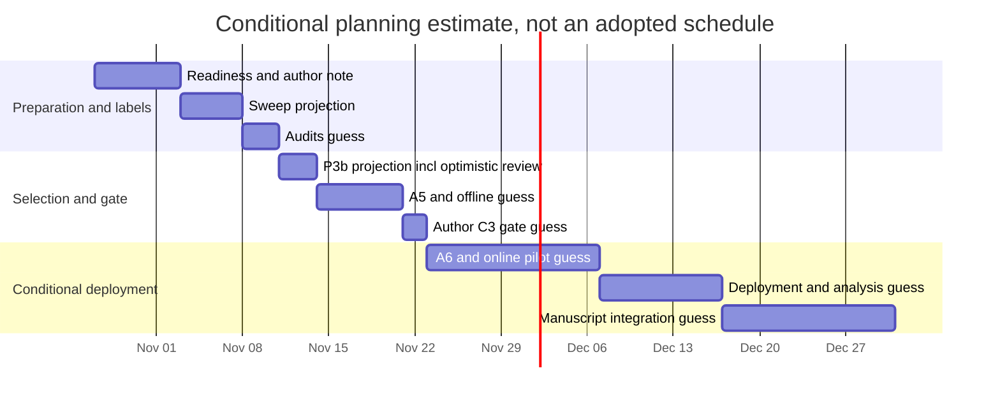

# ICML 2027 feasibility and timeline proposal

AI-assisted, 27 October 2026. **Proposal, not an adopted plan or authorization.** The author decides scope and dates in PLAN §10; only then may the coordinator re-date RUNBOOK. This is a conditional scheduling calculation, not a promise of host availability, passing gates, or evidence quality.

## Date basis and method

Checked 27 October 2026: the official [ICML future meetings page](https://icml.cc/Conferences/FutureMeetings) lists 2027 in South America but supplies no submission deadlines; the 2027 conference page was inaccessible to this check. The official [2026 dates](https://icml.cc/Conferences/2026/Dates) give abstract and paper deadlines of 23 and 28 January 2026. The local Mac runbook proposes **estimates** of 16 January 2027 for an abstract and 22 January 2027 for a paper (`prompts/MAC_LOCAL_RUNBOOK.md`, L3); neither is an official 2027 date. Recheck official dates before any reliance.

From 27 October to the estimated dates are 81 and 87 calendar days, respectively (`date(2027,1,16) - date(2026,10,27)` and `date(2027,1,22) - date(2026,10,27)`). The schedule below uses calendar days, a stated optimistic start, and no allowance for queues, author availability, interruptions or failed gates unless explicitly shown. “Measured” means a past recorded run, not a forecast. “Projected” means a runbook estimate. “Guessed” means a planning assumption made here without a measurement. All provisional dates and durations below are guesses unless another label is stated.

## Conditional partial path, not the full-route critical path

The following compact calculation assumes each predecessor finishes on its shown date, the author responds inside the indicated allocation, the early label set reaches P.3b by the end of audit allocation, the host-equivalence check and the C3/RL gates pass, and all separate authorization notes and reviews are in place. Failure, delay or an author decision can change the path. In particular P.3a is label-free and may run in parallel with the sweep, whereas P.3b needs its early training-partition label set and P.4 needs the full B.2 table (RUNBOOK B.1–B.7, Track P; Track P runbook phases 5–8).

| Step and owner / host | Dependency | Duration and source | Optimistic window | Single point of failure |
|---|---|---|---|---|
| Remaining host checks, liveness and sweep readiness / deepthought agent + author | Accepted host setup, pins, D28; author note | 7 days **guessed** for unresolved work and response; runbook phase estimates are projections, not evidence (`prompts/DEEPTHOUGHT_SWEEP1_RUNBOOK.md`, phases 2–6b) | 27 Oct–2 Nov | Full offload, node liveness, disk/file quota, author authorization. The 25 Oct CPU climate pilot and runner/offload issues in local records are not sweep readiness. |
| B.1 sweep / deepthought agent | Author A.9 note and matching pins | 5 days **projected upper end** (`DEEPTHOUGHT_SWEEP1_RUNBOOK.md`, phase 7: ~1–5 days); actual throughput unverified | 3–7 Nov | One pinned host/backend table; runner STOP or failed liveness. |
| B.2 audits and full table / deepthought CPU agent | Sweep output and authorized audit path | 3 days **guessed**, no measured aggregate throughput found | 8–10 Nov | CPU throughput, storage quota, label integrity. Early eligible labels may feed P.3b before completion. |
| Labelled P.3b and author finalist decision / TASL-7 agent + author | Host equivalence, authorized P.3a, early labels, frozen rule and membership | 3 days **projected** for P.3b (`PORTAL_TRACK_P_RUNBOOK.md`, phase 7: ~2–3 days), with author response optimistically included | 11–13 Nov | E0/probes and label headroom; exact rule and author choice. |
| P.4 A5, offline arms and P.4 gate / TASL-7 + Mac agents | Full B.2 table, finalists, P.4 authorization | 7 days **guessed**; model/seed multiplicity and queue overhead not measured | 14–20 Nov | Slow 4B arms, calibration and width gate. |
| B.7 C3 author gate | A3 or A5 vs A2 offline analysis | 2 days **guessed** for review and author decision | 21–22 Nov | A failed gate changes the paper to the declared fallback; it is not a delay to repair silently. |
| Conditional P.5/P.6 and C.3 online pilot / TASL-7 + deepthought | B.7 pass, P.4 RL gate, required notes, H.8 coordination and Track H review | 14 days **guessed**, including integration and review | 23 Nov–6 Dec | Shared H.8 interface, model fit, DI and rollback conditions. |
| D.3 deployment and D.4 analysis / deepthought + TASL-7 | Author D.2 pre-declaration/hash and D.3 authorization; matching and readiness | 10 days **guessed** | 7–16 Dec | Preregistration, manager capacity and fresh-seed audits. |
| Integrate results, proof check, manuscript and reproducibility / Mac + author | D.4, author proof check, scope and framing decisions | 14 days **guessed** | 17–30 Dec | Author proof review, missing outcomes, bibliography and anonymous clean build. |

The table's sequential guessed/projected path is 65 calendar days inclusive, ending 30 December under these assumptions. There are 16 elapsed days between 31 December and the estimated 16 January date, but only 15 whole dates, 1–15 January, strictly between completion and that date; the estimated deadline time zone is unknown. This partial chain omits full-route branches and is **not** an established full-route critical path. The final abstract may need a settled story earlier, and the official deadline can be earlier or later.

## Parallel work and other dependencies

| Work | Owner / host | Estimated time and source | Dependency / constraint |
|---|---|---|---|
| X.2 Stage A, X.4 B1, X.6 B2 | portal agent | Stage A ~1 day, B1 ~3–4 days, B2 ~1–2 days **projected** by `PORTAL_EXAM_RUNBOOK.md` phases 3, 5, 6; downloads and author gates add time | Phase reviews, frozen rule, B1/B2 authorization, author sample-size and role decisions; independent of the first sweep labels. |
| P.3a E0/E6 | TASL-7 agent | Per model <30 minutes each for E0 and E6 **projected** by `TRACK_P_POST_TRAINING.md` §5.4; multiply by candidates and add setup/review, not measured for the full pool | Host equivalence and author note. A single Kev dry run took ~6.6 leased minutes (`reports/TRACKP_P3A_DRYRUN_20261026.md`), but was not evidence and does not establish full-pool duration or passing. |
| H.8 interface and Track H review | Mac agent + coordinator | 3 days **guessed** for coordination, implementation and review | Coordinator approval before edits to shared modules; no Track P train-directory edits. Needed before P.5 and H.10 before C.3. |
| Track G G.1–G.5 | Mac adapter agent, host agents, author | G.1 5 days **guessed proxy**, using the upper end of the local runbook's 3–5 days for all L4 work, not a direct G.1 measurement; downstream actual duration **unknown** | G.2 container access and G.4 role are author decisions; G.5 needs the appropriate adapter and noise checks. It is not a prerequisite for writing D.2. |
| B.6 second sweep | deepthought or declared permitted host | **Unknown**, projected only after proposal throughput and label learning curve; first sweep's ~1–5 days is not a measurement for a second manager | Author decision and separate authorization; optional scope candidate, not silently removed. |
| C.2 aggregation, C.4 DI and memory A/B | deepthought / Ada / Mac + author | C.2 **unknown**; C.4 A/B “a few GPU-hours” **projected** (`RUNBOOK.md`, C.4) | Deployed tabular arm and corresponding authorization; DI endpoint is an author question. Ada runs must be resumable and comply with co-tenancy and Paper A rules. |
| D.1 LONO and transfer | TASL-7 / permitted host + author | 14 days **guessed** in parallel with preparation of D.2 | Model pins, host comparability and author-declared Track G role; D.2 is a separate step. |
| D.2 pre-declaration | author | 3 days **guessed** for writing and review | Contrasts, samples, matched budgets, analysis and hash must be committed before D.3; the scaffold is not an authorization. |

### Illustrative full-route resource-constrained scenario

This is a second, deliberately conservative **guess**, not a measured forecast or a replacement for author scheduling. It serializes work where the same host or author could be a bottleneck, and assumes all gates pass and each unverified prerequisite fits its allocated window. Dates before the C3 gate use the same B.1/B.2 windows above but add Track P and decision overhead explicitly. A different actual schedule may be longer or shorter; any STOP invalidates the downstream dates.

| Remaining work / host and owner | Guessed inclusive window and basis | Prerequisite, resource conflict or unresolved fact |
|---|---|---|
| TASL-7 access, reboot, pinned installation and independently reviewed equivalence / author + Track P agent | 27 Oct–2 Nov, 7 days **guessed** | STATUS host entry lists access and setup as open; the host-change header requires equivalence. No live host state is claimed. |
| P.3a and phase review / TASL-7 + author | 3–5 Nov, 3 days **guessed**, with ~1 day for the run **projected** by Track P runbook phase 5 and 2 days guessed for review/author response | Separate P.3a authorization, host equivalence, open E0 and A3 design questions; B.1 can run concurrently on deepthought. |
| Early labels, split/membership, hashes and PLAN rule record / deepthought, coordinator, author | 11–12 Nov, 2 days **guessed**, after the assumed full B.2 allocation | No cited record demonstrates an incremental published training subset; P.3b requires the origin/main artifact, membership and hashes and an authorization. If publication is unavailable or B.2 takes longer, P.3b moves later. |
| P.3b, phase review and finalist decision / TASL-7 + author | 13–17 Nov, 5 days **guessed**: 3-day projected run plus 2 guessed review/decision days | P.3a, early labels and P.3b authorization; a failure is a STOP. |
| B.3 A0–A3 on Mac; B.4 A4 on deepthought; P.4 A5 on TASL-7 / respective agents | 18–24 Nov, 7 days **guessed** | Full B.2 table; A4 needs pinned manager capacity; P.4 needs finalists and authorization. Runbook phase 8 also requires review and author decision before B.7. Host contention with a second sweep is unresolved. |
| B.7 gate / author | 25–26 Nov, 2 days **guessed** | Offline inputs and P.4 review; a fail triggers the C1+C2 fallback. |
| P.5/P.6 and C.3 / TASL-7 + deepthought | 27 Nov–10 Dec, 14 days **guessed** | Gate pass, P.4 RL gate, separate notes, H.8 coordination and H.10 review. The 4B sidecar and manager share constrained host resources. |
| B.6 second manager sweep and audits / deepthought + author | 27 Nov–8 Dec, 12 days **guessed**: 5-day first-sweep upper-end projection plus 3-day audit guess and 4-day guessed setup/review | Requires Track X selection, an author decision and its own authorization; actual manager fit, audit throughput and contention with C.3 are unknown. This is a scheduling placeholder, not a measured budget. |
| C.2 aggregation and C.4 / deepthought, Mac, permitted Ada + author | 11–17 Dec, 7 days **guessed** | Deployed tabular arm, authorization and DI endpoint; C.4 runtime “a few GPU-hours” is only a RUNBOOK projection. We serialize deepthought work with D.3 here, but actual contention may be worse. |
| D.2 and D.3–D.4 / author, deepthought, TASL-7 | D.2 11–13 Dec, 3 days **guessed** in parallel with C.2; D.3–D.4 18–27 Dec, 10 days **guessed** | The actual declaration and hash precede D.3 authorization; C.3 and relevant host readiness precede deployment. No author note is drafted or assumed. |
| D.1 LONO / TASL-7; G.1–G.4 / Mac and authorized host | D.1 28 Dec–10 Jan, 14 days **guessed**, after A6 and serialized after D.3; G.1–G.4 27 Oct–14 Nov, 19 days **guessed** | A6 pins; author role/audit decision, container access and noise checks. Sharing TASL-7 with deployment is not assumed away. |
| G.5 transfer / authorized host | 11–17 Jan, 7 days **guessed** | Appropriate G readiness, author scope and model pins; same-table host restrictions apply. No actual host allocation is established. |
| E.1–E.3 integration, new novelty sweep, full-text checks, disclosure and anonymized artifact / Mac + author | 18–31 Jan, 14 days **guessed** | Required final outcomes, proofs, transfer and author scope; this conservative scenario ends 15 calendar days after the **estimated** 16 Jan abstract date. An early abstract or parallel draft may be possible but is not established by this chain. |

Per-host demand beyond the stated first-sweep and exam runbook projections remains unknown: P.3/P.4/P.5, D.1/D.3, B.6 and the B.2 CPU audits have no verified full workload budget here. The single-model portal DRYRUN is not an extrapolated full-pool budget. Resource ceilings below therefore cannot be treated as planned utilisation. The complete route has no defensible measured critical-path estimate within a day per phase; the table is an explicitly conditional scenario for the author's scope decision.

## Compute envelope and bottlenecks

For illustration only, the 81-day interval gives a theoretical upper bound of 1,944 card-hours per single continuously available card (`81 × 24`): 7,776 across four deepthought cards, 1,944 for the portal, 1,944 for TASL-7, and 15,552 across eight Ada cards. These are **capacity ceilings, not available allocations or forecasts**. They assume uninterrupted 24-hour occupancy, which is not established; deepthought's usable full-offload route, portal/Track X workload, TASL-7 readiness, Ada sharing, preemption, author decisions and operational limits all reduce actual availability. Utilisation and remaining allocatable GPU-hours are **unknown**; no live remote census was performed.

| Host | Proposed load and evidence | Main constraint |
|---|---|---|
| deepthought | Sweep 1 ~1–5 days projected for one card; B.2 CPU audits, B.6 if adopted, C.2, deployment manager (`DEEPTHOUGHT_SWEEP1_RUNBOOK.md`, phases 7–8; RUNBOOK B/C/D) | Runner/full offload unresolved in local preparation records; liveness and audit throughput unknown. |
| portal | X Stage A/B1/B2 as projected above; no Track P after migration (R1-EXAM-HOST, R1-TASL7-TRACKP) | One card, model fit and author evidence gates; total GPU-hours remain unknown. |
| TASL-7 | P.3a/P.3b, A5, conditional A6/R-B and 4B arms | Host setup, same-environment equivalence and author decisions. A prior portal DRYRUN is not host-equivalence evidence. |
| Ada | Resumable Track G, LONO or replicate overflow if adopted (R1-ADA-OVERFLOW) | Shared/preemptible, Paper A coordination, equal host type/environment per comparison unless prospectively declared; available capacity unknown. |

## Scope choices for the author

| Option | Proposal and consequence for PLAN §9 quality bar |
|---|---|
| Full route | Keep B.6, R-B, Track G/MLGym and C4 A/B if gates and authorization permit. Strongest prospective generalisation and three-way comparison, but maximum dependence on labels, hosts and audits. |
| Focused C1–C3 | Consider deferring B.6, R-B, MLGym or C4 A/B separately. Deferring the second manager conflicts with PLAN §9's second-manager generalisation requirement unless the author changes scope; deferring hard benchmarks weakens the held-out-benchmark requirement. R-B/C4 deferral does not itself waive the predeclared three-way comparison, matched baselines, action/information ablations, proof, reproducibility or positioning obligations. Do not claim omitted evidence or silently waive the quality bar. |
| Gate-failure fallback | If B.7 fails, report the measured negative and C1 + C2 as prescribed by the C3 gate row. This is a conditional author-adopted fallback, not a prediction that the gate will fail. |

## Risk register and early signals

| Risk | Early signal | Fallback or decision |
|---|---|---|
| Insufficient eligible labels or weak A5 learning curve | Audited non-inert count and held-out RPS skill; record split integrity | Author decides whether B.6 or scope change is justified; do not mix label/evaluation seeds. |
| C3 gate fails | Declared A3/A5 vs A2 estimate and lower bound | Apply the fixed negative/fallback rule, without tuning g or threshold. |
| `digits_mlp` liveness fails | D28 report under pinned llama.cpp manager | Preserve failure; author chooses repair, reserve or pool scope under the runbook. |
| Deepthought offload or file quota | Measured offload telemetry and filesystem file-count as well as byte capacity | STOP as prescribed; preserve attempts and request author decision, not a silent host substitution. |
| Track G container access | G.2 check by authorized host owner | Author decides feasible benchmark scope; no guessed access. |
| Dates, proof and author capacity | Official CFP or proof-audit gaps and outstanding author gates | Re-date only after author decision; C1 + C2 fallback remains conditional on its own evidence and proof checks. |

**Questions for the author:** Which conditional scope option should be planned? What author response windows are realistic? If official ICML dates differ, what freeze date should replace the estimates? Which non-critical work is allowed to move to appendix or later publication?
