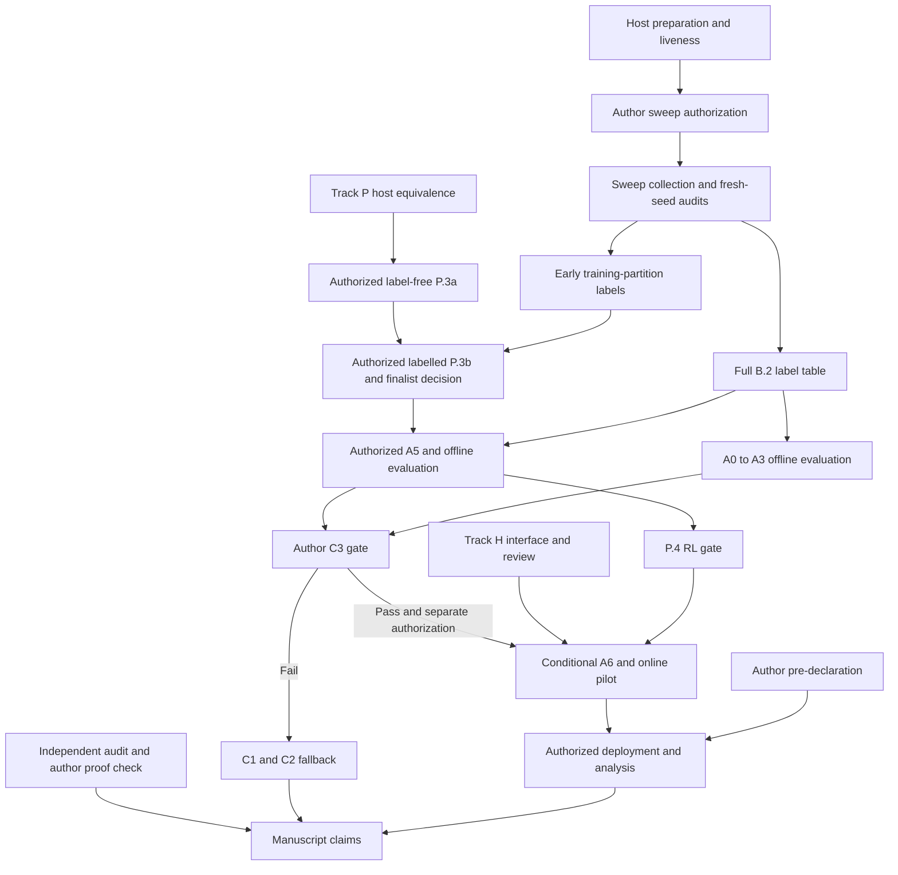

# Paper B R1 — technical route

AI-assisted route summary, 27 October 2026. This is a navigation document, not a decision, evidence run, proof check, pre-declaration or authorization. The dated rows of [PLAN §10](PLAN.md) control; execution and progress are in [RUNBOOK](RUNBOOK.md) and [STATUS](STATUS.md). Earlier prose in those files and the linked design documents may be historical. Open decisions are in [route proposals](proposals/ROUTE_PROPOSALS_20261027.md).

## Problem and framing

A governed autoresearch loop proposes bounded edits, executes them under a budget and keeps or discards candidates against an incumbent. Observations are noisy and the recorded incumbent can be selected on noise. The principal outcome is the final incumbent's fresh-seed audited improvement on held-out instances, under matched worker and LLM-call budgets; the in-run record is not that outcome (PLAN §§2, 4; R1-REFRAME and R1-INDEX).

Two framings remain visible until the author decides: (A) dynamic algorithm configuration under noise, with the whole loop as the configured process and single-proposal control as a contextual-bandit problem; (B) noise-aware agent control, using DAC for the interface and related work. R1-ROUTE currently adopts B; R1-DAC-INTERFACE adopts an interface without deciding the headline. Any claim about the degree of sequential feedback needs its stated assumptions and measurement (route proposal R1 and R9).

**Open decisions:** headline framing and the scope of feedback claims.

## Contributions and evidence needed

| Contribution | Planned claim or question | Evidence needed |
|---|---|---|
| C1 | Measure control errors and wasted runs, including rule-detectable duplicates and no-ops | Accepted common noise floor and fresh-seed audits of the declared population, with node and memory-mode breakdowns (R1-C1-FLOOR; 22 Oct duplicates row). |
| C2 | Acceptance and screening under noise, record bias and decision independence | T2 and T4 statements with assumptions, independent audit, author's proof check and empirical checks where applicable (PLAN §9; R1-C3; R1-C4). Theorems are not yet author checked. |
| C3 | Measure what a learned per-proposal forecast and the declared decision rules add beyond A2 | Disjoint label/evaluation seeds, held-out instances, calibrated comparisons and the author-decided C3 gate before online deployment (C3 gate; D18; 22 Oct g and accounting rows; R1-C3-POST). |
| C4 | Assess proposer feedback and the debiased-memory intervention as a secondary contribution | Matched-history analysis with an author-approved endpoint and the declared intervention; the partial diagnostic remains PILOT, not causal evidence (R1-C4; partial rerun-2 arm A row; proposal R7). |

If the C3 gate fails, the declared fallback is C1 plus C2 with C3 reported as the measured negative; no outcome is assumed here (C3 gate). **Open decisions:** DI endpoint and strength of any feedback claim; proof and evidence gates remain outstanding.

## Theory in brief

T2 considers a noisy increment and an incumbent-relative decision. Under its stated normal assumptions, the posterior-mean rule yields a threshold, and the value of verification is compared with its cost. T4 conditions on a proposal and history, develops threshold-gain and screening expressions under its assumptions, and states a decision-independence condition for a myopic rule. T3 and T5 are simulations of models, not measurements of the real loop. These descriptions do not assert that every stated proof or condition is correct; the independent audit and author check are separate requirements ([T2](theory/T2_DERIVATIONS.md), [T4](theory/T4_FEEDBACK_PROPOSER.md), [T3](theory/T3_SIMULATION.md), [T5](theory/T5_SIMULATION.md); PLAN §9).

**Open decisions:** how to resolve any audit findings and which revised theoretical claims the author adopts.

## C3 arms and post-training

The adopted ladder is A0 default, A1 constant-prior index, A2 rule-detectable waste, A3 tabular prior, A4 manager zero-shot forecast, A5 supervised decision model and A6 decision-focused stage; reference arms are listed by the R1-C3 ladder row. R1-A1-VERIFY retains A1's KG verify. Later R1-C3-POST separates a probabilistic belief from an execute/skip action output, drops greedy-bin deployment and limits belief training to the declared proper-score framework. The Qwen base control is carried as an ablation (R1-C3-CONTROL). The R-B reasoning arm is a distilled self-control arm with the teacher and data restrictions in R1-RB-TEACHER; no API call is authorized by this document.

The planned comparison includes LLM self-control, trained configurator and hybrid at matched budgets and information, with deployment contrasts pre-declared by the author (RUNBOOK H.7, D.2). Predictions about A6 gains remain hypotheses. **Open decisions:** head form, finalist selection, exact R-A0 rule, permitted hard-label diagnostics, score scaling and shared-representation interpretation (proposals R2–R6).

## Labels, splits and gate

Sweep proposals are audited using the disjoint label and evaluation seed blocks specified in RUNBOOK B.2 and the Track P specification. New soft-label width uses pooled node noise (R1-SOFT-SIGMA). No-ops receive their declared label. Previously evaluated duplicates are excluded from learned labels and learned-arm evaluation sets and counted separately; rule-equipped arms receive credit for skips, while comparator accounting must not erase the costs of duplicate executions (22 Oct duplicates and run-accounting rows). Splits are by instance, with edit-hash grouping and leave-one-node-out evaluation; the decision-model exam uses the training partition (RUNBOOK Track P).

At the C3 gate the author evaluates whether the offline one-step gain of A3 or A5 over A2, scaled to a 20-run campaign, reaches δ_n on at least two nodes, with its lower 95% bound above zero (C3 gate; D18). The primary gate fixes g = 0.1 σ_node, credits skips at that price and does not re-spend freed runs; the declared alternatives are sensitivities without a gate verdict (22 Oct g and run-accounting rows). Passing permits the specified online next phase subject to the other gates; failure yields the declared negative/fallback. The 19 Oct pilot cannot be substituted for this gate ([offline pilot report](reports/C3_OFFLINE_PILOT_20261019.md); STATUS). **Open decisions:** canonical versioned bin edges and any additional label allocation or later sweep authorization.

## Decision-model exam and evaluation

The decision-model exam first screens label-free properties and architecture probes, then uses a fixed training-partition exam set and a rule frozen before labelled selection. Its finalists require the author's confirmation. Supervised and action stages have their own prerequisites and author-written authorizations; the gate does not authorize them by itself (R1-C3-POST; RUNBOOK Track P; `prompts/PORTAL_TRACK_P_RUNBOOK.md`).

The primary deployment outcome and contrasts require an author-written pre-declaration covering H1–H5, instances, sample sizes, matching, analysis and hash (RUNBOOK D.2). Clustered uncertainty, matching and held-out evaluation follow PLAN §9. **Open decisions:** exam finalists, deployment declaration and scope after feasibility review.

## Track G, compute and hosts

R1-BENCH-HARD adds harder benchmarks; their role and audit budget remain open. Adapters and stub smoke tests are Mac engineering work, while any noise floor or transfer workload needs the applicable host, protocol and author decision (RUNBOOK Track G; R1-ADA-OVERFLOW). The proposer exam is portal-only under R1-EXAM-HOST. The C3 label sweep is assigned to deepthought under R1-SWEEP-HOST; Track P moves to TASL-7 with the host-equivalence gate under R1-TASL7-TRACKP. Ada is resumable overflow with the stated table-comparability constraints (R1-ADA-OVERFLOW). Mac work is limited by R1-COMPUTE and R1-TRACKP-RUNBOOK-SCOPE.

**Open decisions:** Track G role, budget and container access; any host changes and evidence authorizations.

## Dependencies

The graph is a compact view, not an exhaustive schedule. The remaining tracks and conditional dependencies are:

| Track | Dependency and authority |
|---|---|
| Proposer exam X | Stage A, author exclusions and frozen rule precede separately authorized B1; B1 results and an author-fixed sample size/authorization precede B2; the author selects by role afterward. Every exam phase has its own independent review (R1-EXAM-PROTOCOL; R1-EXAM-REVIEW; RUNBOOK X.2–X.7). The exam is not a substitute for sweep labels. |
| Track P | Host-equivalence precedes P.3a and later evidence; label-free P.3a can proceed alongside sweep collection. Labelled P.3b needs the specified early training-partition labels, frozen membership/rule and its authorization; it need not wait for the entire B.2 table. The author confirms finalists. P.4 A5 needs the full B.2 table and precedes B.7 when A5 is used; its separate RL gate and authorization govern P.5/P.6 (R1-TASL7-TRACKP; R1-C3-POST; RUNBOOK B.5–B.7 and P.3–P.6; Track P runbook phases 6–8). |
| Other offline work | B.4 calibrates the manager zero-shot A4 arm. B.6 is a later second sweep and manager for expansion; its scope and timing depend on the learning-curve and author decisions, and it is not silently required for the first gate (RUNBOOK B.4–B.6; Track P specification §3.7). |
| Track H, C.2 and C4 | H.1–H.10 are reviewed before C.3; the H.8 amendment needs coordination before P.5. C.2 collects proposals under the deployed tabular arm, audits and retrains in an aggregation round. C4 measures decision independence and the debiased-memory intervention; A7 is conditional on the declared DI result, not presumed (RUNBOOK H.8–H.10, C.2–C.4; R1-C4). |
| Track G and transfer | G.1 adapter smoke and G.3 noise measurement support G.5 transfer; author decides G.4 role and audit budget. D.1 transfer and D.2 author pre-declaration are separate listed steps; neither a Track G role choice nor D.1 is asserted as a prerequisite for writing D.2 (R1-BENCH-HARD; RUNBOOK G.1–G.5, D.1–D.2). |
| Deployment | D.2 pre-declaration and its hash precede author authorization and D.3; D.4 follows deployment. Manuscript claims also require the author proof check and the declared quality bar (RUNBOOK D.2–D.4; PLAN §9). |

Arrows and table entries are dependencies, not permission to start a downstream step. **Open decisions:** scope and timeline are pending the author's L1, L3 and L5 decisions; L7 follows those decisions, not merely the existence of proposals.
